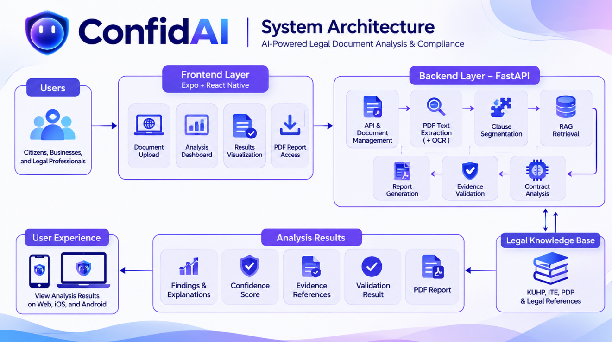

# ConfidAI

## AI-Powered Cybersecurity Contract Intelligence

[**Link Demo ConfidAI**](https://demo-nda.vercel.app/)



ConfidAI merupakan platform berbasis Artificial Intelligence (AI) yang dirancang untuk membantu organisasi mengidentifikasi potensi risiko keamanan siber dalam dokumen Non-Disclosure Agreement (NDA) dan perjanjian kerja sama teknologi.

Dengan menggabungkan **Retrieval-Augmented Generation (RAG)** dan Large Language Model (LLM), ConfidAI menganalisis klausul kontrak berdasarkan referensi hukum dan keamanan siber yang relevan. Sistem menghasilkan temuan risiko beserta alasan, bukti, dan hasil validasi untuk membantu tim legal dan keamanan melakukan evaluasi sebelum perjanjian ditandatangani.

Repositori ini mengelompokkan layanan analisis dan aplikasi hybrid dalam dua direktori:

```text
backend/   FastAPI, OCR, analisis kontrak, RAG, koleksi hukum, dan sampel
frontend/  Expo + React Native untuk web desktop, iOS, dan Android
```

## Fungsionalitas dan Manfaat

ConfidAI menyediakan beberapa fungsionalitas utama untuk mendukung proses evaluasi keamanan kontrak:

### 1. Document Processing & OCR

- Memproses dokumen kontrak dalam format PDF.
- Mengekstraksi teks dari dokumen digital.
- Menggunakan Tesseract OCR untuk membaca dokumen PDF hasil pemindaian (scanned PDF).
- Melakukan segmentasi dokumen menjadi bagian-bagian klausul untuk analisis lebih lanjut.

**Manfaat:** Mengurangi pekerjaan ekstraksi dan pemeriksaan dokumen secara manual, termasuk untuk dokumen hasil pemindaian.

### 2. AI-Powered Contract Analysis

- Menganalisis klausul kontrak menggunakan Large Language Model.
- Mengidentifikasi klausul yang berpotensi menimbulkan risiko keamanan siber.
- Menghasilkan temuan beserta alasan dan tingkat keyakinan model.
- Menyediakan hasil validasi untuk membantu meninjau kualitas temuan.

**Manfaat:** Membantu tim legal dan keamanan menemukan potensi kelemahan dalam perjanjian secara lebih sistematis sebelum kerja sama dimulai.

### 3. Retrieval-Augmented Generation (RAG)

- Mengambil referensi yang relevan dari knowledge base.
- Menggunakan ChromaDB sebagai penyimpanan referensi untuk proses retrieval.
- Memberikan konteks referensi kepada LLM sebelum melakukan analisis klausul.
- Mendukung analisis yang didasarkan pada referensi hukum dan keamanan siber.

**Manfaat:** Mengurangi ketergantungan analisis pada pengetahuan bawaan model dengan menyediakan konteks referensi yang relevan dan dapat ditinjau.

### 4. Evidence & Traceability

- Menampilkan klausul yang menjadi dasar temuan.
- Menyediakan alasan dan bukti pendukung analisis.
- Menampilkan metode atau model yang digunakan.
- Menyediakan informasi hasil validasi.

**Manfaat:** Meningkatkan transparansi hasil analisis sehingga pengguna dapat menelusuri dan memverifikasi dasar setiap temuan.

### 5. Interactive Analysis Dashboard

- Menampilkan graph pipeline pemrosesan dokumen.
- Menyediakan log tekstual untuk setiap tahap analisis.
- Menampilkan hasil temuan dan bukti pendukung.
- Menyediakan tautan laporan setelah proses pembuatan PDF selesai.

**Manfaat:** Mempermudah pengguna memahami proses analisis dan meninjau hasilnya dalam satu antarmuka.

### 6. Report Generation & Job Management

- Menghasilkan laporan analisis dalam format PDF.
- Menyimpan progres pekerjaan analisis.
- Memungkinkan pengguna menghapus progres pekerjaan satu per satu atau sekaligus.
- Menghapus data progres, PDF unggahan, dan file hasil analisis dari storage backend setelah konfirmasi pengguna.

**Manfaat:** Membantu dokumentasi hasil evaluasi dan pengelolaan pekerjaan analisis secara lebih terstruktur.

## Keunggulan ConfidAI

| Keunggulan | Penjelasan |
|---|---|
| Context-Aware Analysis | Menggabungkan RAG dan LLM untuk menganalisis klausul berdasarkan referensi yang relevan. |
| Evidence-Based Findings | Menyediakan alasan, bukti, dan klausul sumber yang dapat ditinjau kembali. |
| Automated Document Processing | Mendukung ekstraksi teks, OCR, dan segmentasi klausul secara otomatis. |
| Human-Centered AI | Membantu pekerjaan tim legal dan keamanan tanpa menggantikan penilaian profesional manusia. |
| Hybrid Multi-platform | Menggunakan Expo dan React Native untuk mendukung web desktop, iOS, dan Android. |
| Flexible Deployment Potential | Arsitektur backend dan AI dapat dikembangkan menuju deployment lokal sesuai kebutuhan infrastruktur organisasi. |

## Dampak yang Diharapkan

ConfidAI berfokus pada pendekatan **proactive cybersecurity**, yaitu mengidentifikasi potensi risiko sebelum kerja sama teknologi dimulai, bukan hanya merespons insiden setelah terjadi.

Beberapa dampak yang diharapkan:

1. **Mengurangi Risiko Keamanan dari Pihak Ketiga**

   Membantu organisasi mengevaluasi ketentuan keamanan, pengelolaan akses, perlindungan data, dan tanggung jawab penyedia layanan dalam perjanjian kerja sama.

2. **Meningkatkan Efisiensi Evaluasi Kontrak**

   Mengurangi pekerjaan pemeriksaan dokumen yang berulang melalui otomatisasi ekstraksi, pencarian referensi, dan analisis klausul.

3. **Meningkatkan Transparansi Pengambilan Keputusan**

   Memberikan temuan yang disertai bukti dan referensi sehingga tim legal maupun keamanan memiliki dasar yang lebih jelas untuk melakukan evaluasi.

4. **Memperkuat Kolaborasi Tim Legal dan Cybersecurity**

   Menyediakan informasi risiko kontraktual yang dapat digunakan bersama oleh tim legal, IT, dan keamanan informasi.

5. **Mendorong Pencegahan Sejak Awal Kerja Sama**

   Membantu organisasi menemukan potensi kelemahan dalam perjanjian sebelum akses sistem, data, atau infrastruktur diberikan kepada pihak ketiga.

> ConfidAI merupakan alat bantu analisis risiko kontraktual. Hasil analisis AI bukan keputusan hukum final dan tetap memerlukan tinjauan manusia.

## Rencana Pengembangan

Pengembangan ConfidAI selanjutnya diarahkan untuk meningkatkan akurasi analisis, memperluas cakupan referensi, memperkuat keamanan sistem, dan meningkatkan aksesibilitas platform.

| Area | Rencana Pengembangan | Tujuan |
|---|---|---|
| RAG & Knowledge Base | Memperluas koleksi referensi hukum, regulasi, dan standar keamanan siber serta meningkatkan relevansi retrieval. | Meningkatkan kualitas konteks dan referensi analisis. |
| AI Analysis | Meningkatkan kualitas analisis klausul, konsistensi temuan, dan validasi keluaran model. | Menghasilkan temuan yang lebih akurat dan relevan. |
| OCR & Document Processing | Meningkatkan akurasi OCR, mempertahankan struktur dokumen, dan mendukung variasi format kontrak. | Memperluas kemampuan pemrosesan dokumen. |
| Evaluation & Benchmarking | Mengembangkan dataset evaluasi dan pengujian terukur terhadap hasil analisis. | Mengukur performa dan konsistensi sistem secara objektif. |
| Security & Deployment | Mengembangkan kontrol akses, pengelolaan data, dan opsi deployment lokal atau isolated environment. | Mendukung kebutuhan keamanan dan privasi organisasi. |
| Mobile Experience | Mengoptimalkan antarmuka dan pengalaman penggunaan pada perangkat iOS dan Android. | Mempermudah akses dan peninjauan hasil analisis melalui perangkat mobile. |
| On-device AI | Mengeksplorasi penggunaan model AI ringan yang dapat dijalankan langsung pada perangkat dengan kapasitas komputasi memadai. | Mengurangi ketergantungan pada server dan meningkatkan fleksibilitas penggunaan. |

### Visi Jangka Panjang

ConfidAI diarahkan menjadi platform Cybersecurity Contract Intelligence yang akurat, adaptif, dan mudah diakses oleh berbagai organisasi.

Dalam jangka panjang, ConfidAI ingin memperluas kemampuan analisis terhadap berbagai jenis perjanjian teknologi, memperkuat integrasi knowledge base, serta mengeksplorasi pemrosesan AI lokal untuk mendukung kebutuhan organisasi dengan tingkat keamanan yang berbeda.

Tujuan akhirnya adalah menjadikan evaluasi keamanan kontrak sebagai bagian dari proses pencegahan risiko siber sejak awal kerja sama.

---

## Menjalankan Backend

Siapkan environment Python dari root:

```bash
python3 -m venv .venv
.venv/bin/python -m pip install -r backend/requirements.txt
```

Konfigurasi backend memakai `.env` di root jika tersedia. Jalankan API:

```bash
PYTHONPATH=backend .venv/bin/python -m uvicorn main:app --app-dir backend --host 0.0.0.0 --port 8000 --reload
```

Untuk menjalankan backend dan frontend web sekaligus di Linux atau Windows, siapkan dependensi sekali lalu jalankan:

```bash
python run.py
```

Panduan lengkap tersedia di [requirements.md](requirements.md).

Dokumen PDF hasil scan memerlukan Tesseract dan data bahasa Indonesia. Lihat [panduan OCR](backend/docs/OCR_INPUT_PIPELINE.md).

Sampel NDA dan kunci evaluasi tersedia di:

```text
backend/samples/
```

## Menjalankan Frontend Expo

Masuk ke direktori frontend dan instal dependensi:

```bash
cd frontend
npm ci
npm run web
```

Untuk menjalankan di simulator atau perangkat:

```bash
npm run android
npm run ios
```

### Konfigurasi API

Frontend membaca variabel lingkungan `EXPO_PUBLIC_API_URL`.

Nilai default:

| Platform | API URL |
|---|---|
| Web / iOS Simulator | `http://localhost:8000` |
| Android Emulator | `http://10.0.2.2:8000` |
| Perangkat fisik | Alamat LAN komputer yang menjalankan backend |

Pada ponsel fisik, atur `EXPO_PUBLIC_API_URL` ke alamat LAN komputer backend.

Origin web lokal sudah diizinkan backend. Origin tambahan dapat diatur melalui `FRONTEND_ORIGINS` pada `.env`.

## Penggunaan Aplikasi

### Analysis Dashboard

Halaman analisis menampilkan:

- Graph pipeline pemrosesan dokumen.
- Log tekstual untuk setiap tahap analisis.
- Keluaran temuan dan alasan analisis.
- Metode atau model yang digunakan.
- Tingkat keyakinan model.
- Bukti dan klausul sumber.
- Hasil validasi.
- Tautan laporan setelah PDF selesai dibuat.

Semua temuan tetap memerlukan tinjauan manusia. Sistem tidak menetapkan pelanggaran hukum final.

### Daftar Pekerjaan

Pada halaman **Daftar Pekerjaan**, pengguna dapat menghapus progres pekerjaan satu per satu atau seluruhnya.

Penghapusan memerlukan konfirmasi dan akan menghapus data progres, PDF unggahan, serta file hasil analisis dari storage backend.

## Dokumentasi Teknis

- [Arsitektur dan penggunaan backend](backend/README.md)
- [Alur OCR](backend/docs/OCR_INPUT_PIPELINE.md)
- [Pemetaan referensi hukum](backend/RAG/LEGAL_MAPPING.md)
- [Status requirements RAG](backend/RAG/README.md)
- [Requirements dan setup Linux/Windows](requirements.md)

---

## Teknologi yang Digunakan

| Komponen | Teknologi |
|---|---|
| Backend | Python, FastAPI |
| Frontend | Expo, React Native |
| Document Processing | Tesseract OCR |
| AI Model | Qwen3:1.7B |
| Retrieval-Augmented Generation | RAG |
| Vector Database | ChromaDB |
| Platform | Web, iOS, Android |

---

**ConfidAI — Because prevention starts before the partnership begins.**